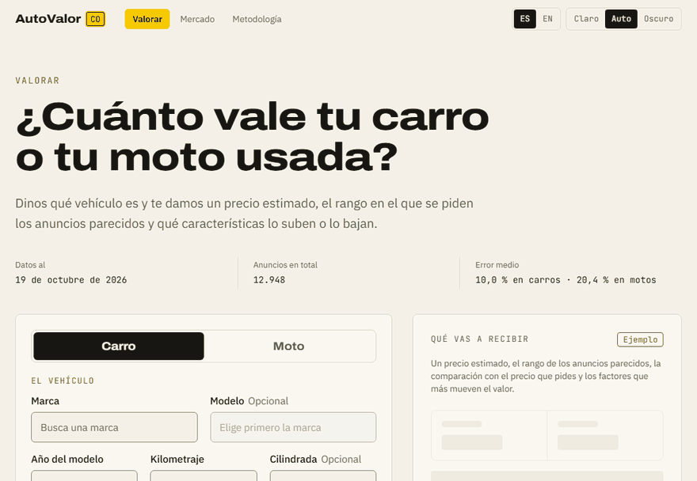
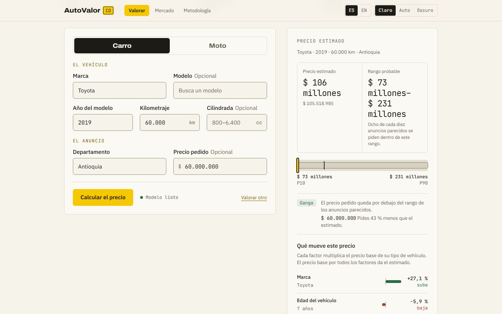
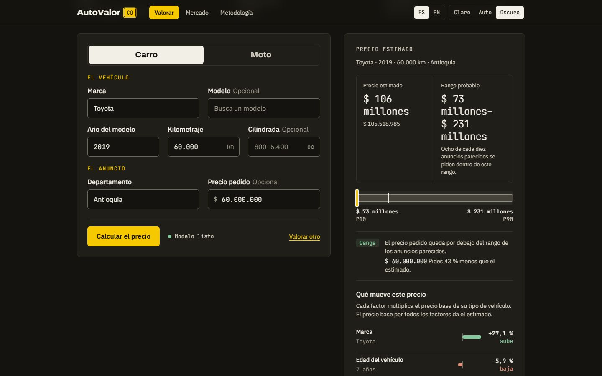
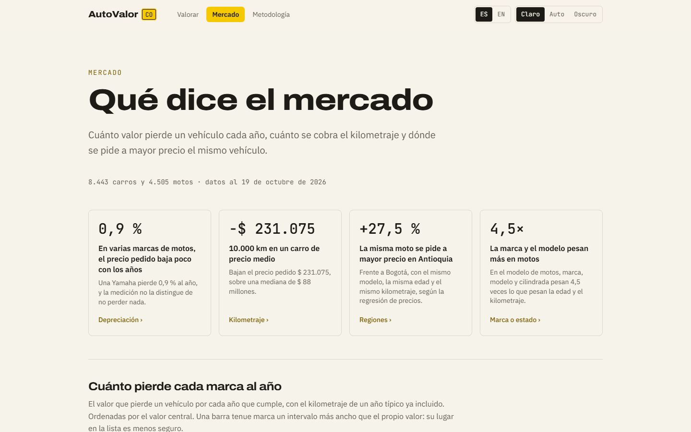
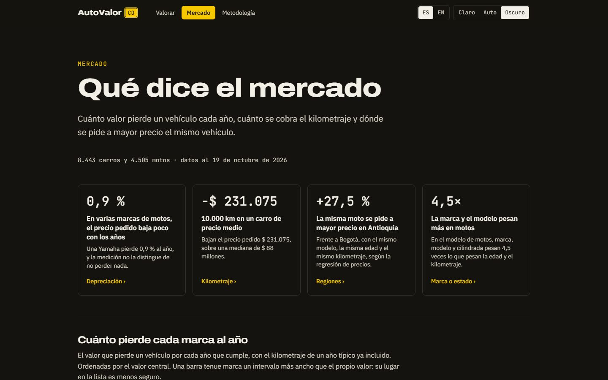
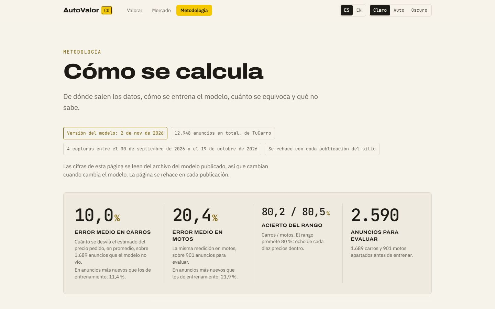
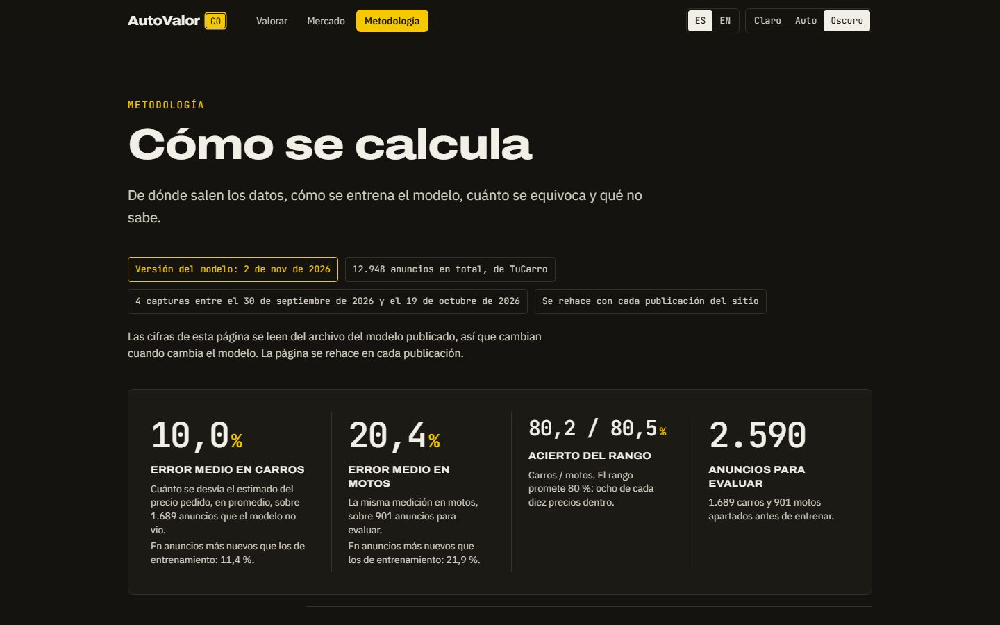
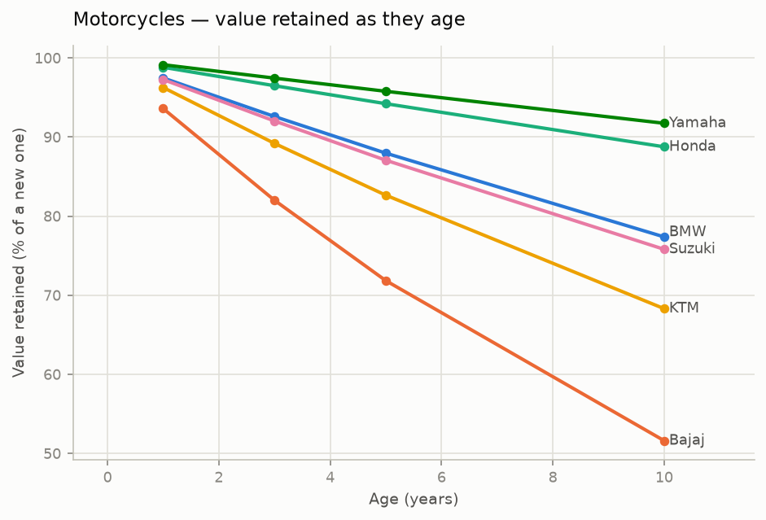
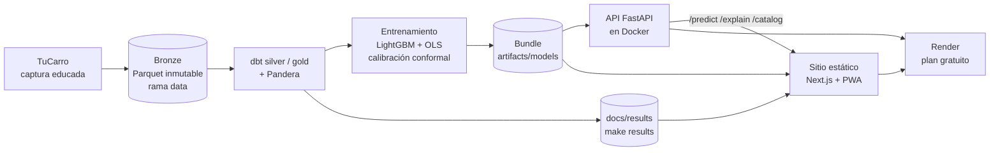
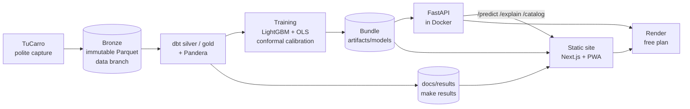

# AutoValor CO

**Cuánto vale un carro o una moto usada en Colombia, con su rango y por qué** ·
_What a used car or motorcycle is worth in Colombia, with its range and the reasons why_

[](https://github.com/JoseRomo16/AutoValorCo/actions/workflows/ci.yml)

[](LICENSE)


**Sitio · _Site_: [autovalor-web.onrender.com](https://autovalor-web.onrender.com)** ·
**API: [autovalor-api.onrender.com/docs](https://autovalor-api.onrender.com/docs)** ·
**Decisiones · _Decisions_: [docs/adr](docs/adr/)**

> La primera valoración puede tardar ~1 min: el plan gratuito de Render duerme la API y el
> arranque en frío carga los dos modelos. Mercado y Metodología son estáticas y abren al
> instante. · _The first valuation can take ~1 min: Render's free plan puts the API to sleep
> and a cold start loads both models. Market and Methodology are static and open at once._



| | Claro · _Light_ | Oscuro · _Dark_ |
| --- | --- | --- |
| **Valorar** · _Value_ | [](https://autovalor-web.onrender.com) | [](https://autovalor-web.onrender.com) |
| **Mercado** · _Market_ | [](https://autovalor-web.onrender.com/mercado/) | [](https://autovalor-web.onrender.com/mercado/) |
| **Metodología** · _Methodology_ | [](https://autovalor-web.onrender.com/metodologia/) | [](https://autovalor-web.onrender.com/metodologia/) |

**[Español](#español)** · **[English](#english)**

---

## Español

### Qué hace y para quién

Comprar o vender un usado en Colombia es negociar a ciegas: los anuncios piden lo que
quieren y la referencia habitual, la guía de Fasecolda, es de suscripción. AutoValor CO es
para quien va a comprar, vender o simplemente comparar: le dice cuánto se pide en el mercado
por un vehículo como el suyo, qué tan seguro está de esa cifra y qué la mueve.

Lo que entrega:

- **Precio estimado** a partir de marca, modelo, año, kilometraje, cilindrada y
  departamento.
- **Rango P10–P90**: dónde se publican ocho de cada diez vehículos comparables, calibrado
  para que esa promesa se cumpla fuera de muestra.
- **Etiqueta ganga / justo / caro** para un precio pedido, **solo donde la banda la
  sostiene**: se publica si la cobertura y el ancho del rango, medidos en el holdout,
  pasan una regla escrita en el código.
- **Factores SHAP**: cuánto sube o baja el precio cada característica de ese vehículo.
- **Mercado**: depreciación por marca, costo del kilometraje, diferencias regionales y
  dónde se equivoca el modelo, cada gráfico con su lectura económica.
- **Metodología**: datos, modelos, métricas fuera de muestra, la regla de la etiqueta y las
  limitaciones, sin suavizarlas.

Sus límites, dichos de frente:

- **Son precios pedidos, no de cierre.** En un mercado donde se regatea, lo que se pide
  queda por encima de lo que se paga, y esa diferencia no está medida.
- **Los datos son un corte fijo**: 4 capturas de TuCarro, del 2026-09-30 al 2026-10-19
  (más el detalle de motos del 2026-10-25). El modelo no se reentrena con datos nuevos, así
  que las cifras describen el mercado de esas semanas.
- **Las motos no llevan etiqueta.** Su rango cubre lo que promete, pero es demasiado ancho
  para separar una ganga de un precio justo; se publican con precio, rango y aviso de
  precisión.
- **Fuera de alcance**: la comparación con Fasecolda (la guía no es pública y la suscripción
  choca con la regla de costo cero) y el índice mensual de precios, que necesita meses de
  histórico que un corte fijo no tiene
  ([ADR 0005](docs/adr/0005-capture-source-after-verification-wall.md)).
- Las estimaciones son informativas y no constituyen un avalúo comercial.

### Resultados

Error medido **fuera de muestra**, sobre anuncios que el modelo nunca vio, y con los mismos
valores que la API envía al valorar ([ADR 0006](docs/adr/0006-drop-city-feature.md)).
Las cifras se generan con `make readme` desde los archivos del modelo y de
[`docs/results/`](docs/results/README.md); nada de este bloque está escrito a mano.

<!-- results:start:es -->

#### Las cifras del modelo servido

|  | Carros | Motos |
| --- | ---: | ---: |
| Anuncios en total | 8.443 | 4.505 |
| Para entrenar | 6.754 | 3.604 |
| Para evaluar | 1.689 | 901 |
| Error medio (MAPE) | **10,0 %** | **20,4 %** |
| Error medio, partición temporal | 11,4 % | 21,9 % |
| Referencia OLS | 12,9 % | 33,2 % |
| Lo que gana el modelo sobre la referencia | 2,9 puntos | 12,8 puntos |
| Cobertura del rango (objetivo 80 %) | 80,2 % | 80,5 % |
| Ancho medio del rango | 39 % | 70 % |
| Etiqueta ganga/justo/caro | publicada | retenida, solo por el ancho |

#### Lo que dicen los datos del mercado

- **Depreciación anual.** En motos va de 0,9 % (Yamaha) a 6,4 % (Bajaj); en carros, de 5,1 % (Volkswagen) a 9,5 % (Ford).
- **Costo del kilometraje.** Cada 10.000 km restan $ 231.000 en el carro mediano ($ 88 millones, 53.600 km) y $ 121.000 en la moto mediana ($ 15 millones, 17.000 km).
- **Diferencias regionales.** El mismo carro se pide 7,6 % más caro en Santander que en Bogotá D.C.; en motos la brecha va de 27,5 % (Antioquia) a −24,5 % (Quindío).
- **Dónde falla más el modelo de carros.** Mercedes-Benz, con 14,1 % de error medio sobre 92 anuncios.

Generado por `make readme` desde `artifacts/models/*/model.json` y `docs/results/`. Modelo `2026-11-02.12948`, con 4 capturas entre 2026-09-30 y 2026-10-19 (19,5 días).

<!-- results:end:es -->

**Cómo leerlo.** Carros cumplen con holgura la meta del proyecto (MAPE ≤ 15 %) y su rango
pasa la regla, así que publican etiqueta. En motos el modelo le gana por mucho a la
referencia OLS, pero el rango es demasiado ancho para calificar un precio: la etiqueta se
retiene aunque la cobertura esté en su sitio. La partición temporal, que evalúa en los
anuncios más nuevos, se publica al lado como segunda medición y nunca en lugar de la
principal.



Las tablas completas con intervalos de confianza y las demás figuras están en
[`docs/results/`](docs/results/README.md) y [`docs/figures/`](docs/figures/).

### Arquitectura



Carros y motos son modelos separados y el objetivo es siempre `log(precio)`. Mercado y
Metodología leen `docs/results/` y `model.json` **al construir el sitio**, no por HTTP;
solo el formulario de Valorar llama a la API.

| Capa | Herramientas |
| --- | --- |
| Captura | httpx, BeautifulSoup, Playwright, tenacity |
| Almacén | Parquet, DuckDB, dbt-duckdb, rama `data` de git |
| Calidad de datos | Pandera |
| Modelación | scikit-learn, statsmodels (OLS con HC3), LightGBM, CatBoost, Optuna, SHAP, MLflow |
| Servicio | FastAPI, Pydantic, Uvicorn, Docker |
| Frontend | Next.js (App Router, export estático), TypeScript, Tailwind CSS, service worker propio |
| Infra | uv, GitHub Actions, Dependabot, Render (plan gratuito) |

### Decisiones de ingeniería

Cada decisión que cambia la forma del sistema queda como ADR en [`docs/adr/`](docs/adr/).

- **[0001](docs/adr/0001-record-architecture-decisions.md), registrar decisiones.** Toda
  decisión no trivial se escribe con contexto, decisión y consecuencias; un cambio de rumbo
  es un ADR nuevo, no una edición.
- **[0002](docs/adr/0002-weekly-capture-storage.md), dónde guardar las capturas.** Primero
  como artefactos de Actions, con 90 días de vida, aceptando ese plazo como límite para
  migrar.
- **[0003](docs/adr/0003-tree-model-validation.md), cómo se validan los árboles.** Los
  ensambles reciben las categóricas crudas y se ajustan con K-fold agrupado por vehículo,
  porque el mismo carro reaparece con otro ID y partir por filas filtraba el holdout.
- **[0004](docs/adr/0004-capture-history-storage.md), el histórico en una rama.** Las
  capturas viven en la rama huérfana `data` del propio repositorio: sin cuentas, sin
  secretos y sin costo, en vez de un almacenamiento de objetos que pide tarjeta.
- **[0005](docs/adr/0005-capture-source-after-verification-wall.md), detener la captura
  sin evadir el bloqueo.** Cuando TuCarro empezó a pedir verificación de cuenta, la captura
  se detuvo en la primera respuesta en vez de rotar IP, user-agent o navegador. Correrla
  desde una IP residencial se descartó por ser evasión, y la API oficial de Mercado Libre
  se midió con un token válido: responde `403` a la búsqueda de vehículos. El proyecto
  cierra con un corte fijo.
- **[0006](docs/adr/0006-drop-city-feature.md), modelo sin ciudad y paridad
  entrenamiento–servicio.** El formulario pide departamento, así que la API mandaba
  siempre la misma ciudad y el rango publicado cubría menos de lo que decía. La ciudad
  salió del modelo, las cifras se miden con los valores que `/predict` envía de verdad y una
  prueba de paridad impide que esa brecha vuelva a abrirse.
- **[0007](docs/adr/0007-pwa-cache-strategy.md), una PWA sin dependencias.** Un service
  worker de ~150 líneas escrito a mano y generado tras el build: páginas primero desde la
  red, archivos con hash desde caché, la API nunca desde caché (salvo `/catalog` como
  respaldo marcado sin conexión) y un worker de emergencia para retirarlo.

### Calidad

| Qué | Cómo | Comando |
| --- | --- | --- |
| Python: pruebas y cobertura | pytest, cobertura mínima del 70 % en `src/` (falla por debajo) | `make test` |
| Python: lint y tipos | ruff (lint y formato) y mypy sobre `src/` y `tests/` | `make lint` |
| Frontend: unidades | vitest con Testing Library, incluidas pruebas de textos ES/EN | `npm test` |
| Frontend: lint y tipos | ESLint y `tsc --noEmit` | `npm run lint`, `npx tsc --noEmit` |
| End-to-end | Playwright sobre el export estático **contra la API real** levantada en local: regresiones, PWA, sin conexión y comportamiento global | `npm run e2e` |
| Accesibilidad visual | auditoría en CI de contraste, tamaño mínimo de texto y áreas de toque, con su propia autoprueba (`e2e/audit.ts`) | parte de `npm run e2e` |
| Imagen de la API | CI construye `Dockerfile.api`, vigila su tamaño y la arranca con el entorno de `render.yaml` | GitHub Actions |
| Cifras publicadas | `tests/test_readme.py` falla si este README no coincide con los archivos del modelo | `make readme` |

Los comandos de `npm` se corren en `frontend/`. Antes de `npm run e2e`, construye el sitio
contra la API local: `NEXT_PUBLIC_API_BASE_URL=http://localhost:8000 npm run build`.

### Cómo correrlo en local

Requisitos: Python 3.12, [uv](https://docs.astral.sh/uv/) y Node.js 22.

```bash
git clone https://github.com/JoseRomo16/AutoValorCo.git
cd AutoValorCo
cp .env.example .env
make setup            # uv sync + navegador de Playwright + npm install en frontend/

# Pipeline (el lago se reconstruye desde la rama data, sin volver a capturar)
make pull-history     # trae las capturas publicadas a data/bronze
make transform        # dbt silver y gold + validaciones Pandera
make export-model     # entrena el modelo servido en artifacts/models/ (~15 min)
make results          # resultados económicos a docs/results y docs/figures (~17 min)
make readme           # regenera las cifras de este README

# Servicio y sitio
make serve            # API en http://localhost:8000/docs
make web              # sitio en http://localhost:3000
```

En **Windows**, sin GNU make, el mismo flujo con el script equivalente:

```powershell
Copy-Item .env.example .env
.\make.ps1 setup
.\make.ps1 transform
.\make.ps1 serve
```

El sitio usa la API desplegada salvo que `frontend/.env.local` diga
`NEXT_PUBLIC_API_BASE_URL=http://localhost:8000`. En redes que inspeccionan TLS hay que
poner `AUTOVALOR_USE_SYSTEM_CERTS=true` en el `.env`. El despliegue en Render se describe
paso a paso en [`docs/deploy-render.md`](docs/deploy-render.md): primero la API, después el
sitio.

### Estructura del repositorio

```text
src/autovalor/
  ingest/       capturador educado de TuCarro y páginas de detalle
  quality/      esquemas Pandera
  features/     variables derivadas
  models/       entrenamiento, banda conformal, regla de la etiqueta, bundle servido
  analysis/     hedónico OLS con HC3: resultados económicos (y el índice, no publicado)
  api/          FastAPI
  readme.py     el bloque de cifras de este README
dbt/            modelos silver y gold
artifacts/      modelos servidos (van dentro de la imagen de la API)
frontend/       Next.js + Tailwind: app/, components/, lib/, tests/, e2e/
notebooks/      04_resultados_economicos (solo exploración)
scripts/        GIF de Valorar y sonda de la API de Mercado Libre
tests/          pytest
docs/           adr/, results/, figures/, design/, reports/, STATUS.md, deploy-render.md
.github/        CI, Dependabot y los workflows de captura (deshabilitados)
```

### Datos y ética

- **Fuente**: anuncios públicos de TuCarro. Corte fijo de 4 capturas, del 2026-09-30 al
  2026-10-19, más el detalle de motos del 2026-10-25. Las capturas están publicadas en la
  rama [`data`](https://github.com/JoseRomo16/AutoValorCo/tree/data), así que cualquier
  cifra se puede rehacer desde el principio.
- **Scraping educado**: se respeta `robots.txt`, hay pausas aleatorias entre peticiones, el
  user-agent es identificable y no hay paralelismo agresivo. Ante la verificación de cuenta
  la captura se detuvo; no se esquivó.
- **Sin datos personales**: nunca se guardan nombres, teléfonos ni correos de vendedores,
  conforme a la **Ley 1581 de 2012**. La capa bronze es inmutable, con `captured_at` y
  `source_url` en cada fila.
- **Costo cero** como restricción de diseño: plan gratuito de Render, sitio estático, el
  histórico en una rama de git y el repositorio público, que es lo que hace gratis a GitHub
  Actions.

### Estado y trabajo futuro

**Proyecto completo.** Las fases F0 a F4 están cerradas, la API y el sitio están
desplegados, y el estado detallado y la deuda conocida están en
[`docs/STATUS.md`](docs/STATUS.md). Trabajo futuro posible, sin fechas:

- Usar el catálogo de atributos de Mercado Libre (`/categories/MCO1744/attributes`) para
  normalizar y validar marca, modelo y año.
- Un objetivo multicuantil, o cuantiles con monotonicidad impuesta, para angostar la banda
  de motos.
- El gráfico de barras de SHAP en los resultados.

---

## English

### What it does and for whom

Buying or selling a used vehicle in Colombia means negotiating blind: listings ask what
they like, and the usual reference, the Fasecolda guide, is behind a subscription.
AutoValor CO is for anyone about to buy, sell or just compare: it says what the market asks
for a vehicle like theirs, how sure it is of that figure and what moves it.

What it delivers:

- **An estimated price** from make, model, year, mileage, engine size and department.
- **A P10–P90 range**: where eight in ten comparable vehicles are listed, calibrated so that
  promise holds out of sample.
- **A bargain / fair / expensive label** for an asking price, **only where the band supports
  it**: it is published if the range's coverage and width, measured on the holdout, pass a
  rule written in code.
- **SHAP factors**: how much each feature of that vehicle raises or lowers the price.
- **Market**: depreciation by make, what mileage costs, regional differences and where the
  model errs, each chart with its economic reading.
- **Methodology**: data, models, out-of-sample metrics, the label rule and the limitations,
  unsoftened.

Its limits, stated plainly:

- **These are asking prices, not sale prices.** In a market where people haggle, what is
  asked sits above what is paid, and that gap is not measured.
- **The data is a fixed cut**: 4 TuCarro captures, 2026-09-30 to 2026-10-19 (plus the
  motorcycle detail pages of 2026-10-25). The model is not retrained on new data, so the
  figures describe the market of those weeks.
- **Motorcycles carry no label.** Their range covers what it promises but is too wide to
  tell a bargain from a fair price; they are published with a price, a range and a
  precision notice.
- **Out of scope**: the Fasecolda comparison (the guide is not public and a subscription
  breaks the zero-cost rule) and the monthly price index, which needs months of history a
  fixed cut does not have
  ([ADR 0005](docs/adr/0005-capture-source-after-verification-wall.md)).
- Estimates are informational and are not a commercial appraisal.

### Results

Error measured **out of sample**, on listings the model never saw, and with the same values
the API sends when it values a vehicle ([ADR 0006](docs/adr/0006-drop-city-feature.md)).
`make readme` generates these figures from the model files and
[`docs/results/`](docs/results/README.md); nothing in this block is typed by hand.

<!-- results:start:en -->

#### Figures for the served model

|  | Cars | Motorcycles |
| --- | ---: | ---: |
| Listings in total | 8,443 | 4,505 |
| Used for training | 6,754 | 3,604 |
| Used for evaluation | 1,689 | 901 |
| Mean error (MAPE) | **10.0 %** | **20.4 %** |
| Mean error, time-ordered split | 11.4 % | 21.9 % |
| OLS reference | 12.9 % | 33.2 % |
| What the model gains over the reference | 2.9 points | 12.8 points |
| Range coverage (80 % target) | 80.2 % | 80.5 % |
| Mean range width | 39 % | 70 % |
| Bargain/fair/expensive label | published | withheld, on width alone |

#### What the market data says

- **Annual depreciation.** Motorcycles run from 0.9 % (Yamaha) to 6.4 % (Bajaj); cars from 5.1 % (Volkswagen) to 9.5 % (Ford).
- **What mileage costs.** Every 10,000 km take COP 231,000 off the median car (COP 88M, 53,600 km) and COP 121,000 off the median motorcycle (COP 15M, 17,000 km).
- **Regional spread.** The same car is asked 7.6 % dearer in Santander than in Bogotá D.C.; for motorcycles the gap runs from 27.5 % (Antioquia) to −24.5 % (Quindío).
- **Where the car model is weakest.** Mercedes-Benz, at 14.1 % mean error over 92 listings.

Generated by `make readme` from `artifacts/models/*/model.json` and `docs/results/`. Model `2026-11-02.12948`, from 4 captures between 2026-09-30 and 2026-10-19 (19.5 days).

<!-- results:end:en -->

**How to read it.** Cars meet the project's target (MAPE ≤ 15 %) with room to spare and
their range passes the rule, so they carry the label. On motorcycles the model beats the
OLS reference by a wide margin, but the range is too wide to rate a price: the label is
withheld even though coverage is where it should be. The time-ordered split, which
evaluates on the newest listings, is published beside the headline figure as a second
measurement, never in its place.


Full tables with confidence intervals and the remaining figures are in
[`docs/results/`](docs/results/README.md) and [`docs/figures/`](docs/figures/).

### Architecture



Cars and motorcycles are separate models and the target is always `log(price)`. Market and
Methodology read `docs/results/` and `model.json` **when the site is built**, not over
HTTP; only the Value form calls the API.

| Layer | Tools |
| --- | --- |
| Capture | httpx, BeautifulSoup, Playwright, tenacity |
| Storage | Parquet, DuckDB, dbt-duckdb, a git `data` branch |
| Data quality | Pandera |
| Modeling | scikit-learn, statsmodels (OLS with HC3), LightGBM, CatBoost, Optuna, SHAP, MLflow |
| Serving | FastAPI, Pydantic, Uvicorn, Docker |
| Front end | Next.js (App Router, static export), TypeScript, Tailwind CSS, a hand-written service worker |
| Infra | uv, GitHub Actions, Dependabot, Render (free plan) |

### Engineering decisions

Every decision that changes the shape of the system is an ADR in [`docs/adr/`](docs/adr/).

- **[0001](docs/adr/0001-record-architecture-decisions.md), record decisions.** Every
  non-trivial decision is written down with context, decision and consequences; a change of
  course is a new ADR, not an edit.
- **[0002](docs/adr/0002-weekly-capture-storage.md), where captures go.** First as Actions
  artifacts with a 90-day life, taking that window as the deadline to move.
- **[0003](docs/adr/0003-tree-model-validation.md), how the trees are validated.** The
  ensembles get raw categoricals and are tuned with K-fold grouped by vehicle, because the
  same car reappears under a new id and a row split leaked into the holdout.
- **[0004](docs/adr/0004-capture-history-storage.md), history on a branch.** Captures live
  on the repository's own orphan `data` branch: no accounts, no secrets and no cost, instead
  of object storage that asks for a card.
- **[0005](docs/adr/0005-capture-source-after-verification-wall.md), stop the capture
  without evading the block.** When TuCarro started asking for account verification, the
  capture stopped at the first answer instead of rotating IPs, user-agents or browsers.
  Running it from a residential IP was rejected as evasion, and Mercado Libre's official API
  was measured with a valid token: it answers `403` to the vehicle search. The project
  closes on a fixed cut.
- **[0006](docs/adr/0006-drop-city-feature.md), no city in the model, and training–serving
  parity.** The form asks for the department, so the API always sent the same city and the
  published range covered less than it claimed. City left the model, the figures are
  measured with the values `/predict` really sends, and a parity test keeps that gap from
  reopening.
- **[0007](docs/adr/0007-pwa-cache-strategy.md), a PWA with no dependencies.** A ~150-line
  hand-written service worker generated after the build: pages network-first, hashed files
  from cache, the API never from cache (except `/catalog` as a flagged offline fallback),
  and an emergency worker to retire it.

### Quality

| What | How | Command |
| --- | --- | --- |
| Python: tests and coverage | pytest, 70 % minimum coverage on `src/` (fails below) | `make test` |
| Python: lint and types | ruff (lint and format) and mypy over `src/` and `tests/` | `make lint` |
| Front end: units | vitest with Testing Library, including ES/EN copy tests | `npm test` |
| Front end: lint and types | ESLint and `tsc --noEmit` | `npm run lint`, `npx tsc --noEmit` |
| End-to-end | Playwright over the static export **against the real API** started locally: regressions, PWA, offline and global behaviour | `npm run e2e` |
| Visual accessibility | a CI audit of contrast, minimum text size and touch targets, with its own self-test (`e2e/audit.ts`) | part of `npm run e2e` |
| API image | CI builds `Dockerfile.api`, checks its size and starts it with `render.yaml`'s environment | GitHub Actions |
| Published figures | `tests/test_readme.py` fails if this README does not match the model files | `make readme` |

The `npm` commands run in `frontend/`. Before `npm run e2e`, build the site against the
local API: `NEXT_PUBLIC_API_BASE_URL=http://localhost:8000 npm run build`.

### Running it locally

Requirements: Python 3.12, [uv](https://docs.astral.sh/uv/) and Node.js 22.

```bash
git clone https://github.com/JoseRomo16/AutoValorCo.git
cd AutoValorCo
cp .env.example .env
make setup            # uv sync + Playwright's browser + npm install in frontend/

# Pipeline (the lake is rebuilt from the data branch, no new capture needed)
make pull-history     # bring the published captures into data/bronze
make transform        # dbt silver and gold + Pandera validations
make export-model     # train the served model into artifacts/models/ (~15 min)
make results          # economic results into docs/results and docs/figures (~17 min)
make readme           # regenerate this README's figures

# Service and site
make serve            # API at http://localhost:8000/docs
make web              # site at http://localhost:3000
```

On **Windows**, without GNU make, the same flow through the equivalent script:

```powershell
Copy-Item .env.example .env
.\make.ps1 setup
.\make.ps1 transform
.\make.ps1 serve
```

The site uses the deployed API unless `frontend/.env.local` sets
`NEXT_PUBLIC_API_BASE_URL=http://localhost:8000`. On networks that intercept TLS, set
`AUTOVALOR_USE_SYSTEM_CERTS=true` in `.env`. Deploying to Render is described step by step
in [`docs/deploy-render.md`](docs/deploy-render.md): the API first, then the site.

### Repository layout

```text
src/autovalor/
  ingest/       polite TuCarro capture and detail pages
  quality/      Pandera schemas
  features/     derived features
  models/       training, conformal band, label rule, served bundle
  analysis/     hedonic OLS with HC3: economic results (and the unpublished index)
  api/          FastAPI
  readme.py     this README's figures block
dbt/            silver and gold models
artifacts/      served models (shipped inside the API image)
frontend/       Next.js + Tailwind: app/, components/, lib/, tests/, e2e/
notebooks/      04_resultados_economicos (exploration only)
scripts/        the Value GIF and the Mercado Libre API probe
tests/          pytest
docs/           adr/, results/, figures/, design/, reports/, STATUS.md, deploy-render.md
.github/        CI, Dependabot and the capture workflows (disabled)
```

### Data and ethics

- **Source**: public TuCarro listings. A fixed cut of 4 captures, 2026-09-30 to
  2026-10-19, plus the motorcycle detail pages of 2026-10-25. The captures are published on
  the [`data`](https://github.com/JoseRomo16/AutoValorCo/tree/data) branch, so any figure
  can be rebuilt from scratch.
- **Polite scraping**: `robots.txt` is respected, requests are spaced by random pauses, the
  user-agent is identifiable and there is no aggressive parallelism. Faced with account
  verification the capture stopped; it was not worked around.
- **No personal data**: seller names, phone numbers and e-mail addresses are never stored,
  as Colombia's **Ley 1581 de 2012** requires. The bronze layer is immutable, with
  `captured_at` and `source_url` on every row.
- **Zero cost** as a design constraint: Render's free plan, a static site, the history on a
  git branch and a public repository, which is what makes GitHub Actions free.

### Status and future work

**The project is complete.** Phases F0 to F4 are closed, the API and the site are deployed,
and the detailed status and known debt are in [`docs/STATUS.md`](docs/STATUS.md) (in
Spanish). Possible future work, with no dates:

- Use Mercado Libre's attribute catalogue (`/categories/MCO1744/attributes`) to normalize
  and validate make, model and year.
- A multi-quantile objective, or quantiles with enforced monotonicity, to narrow the
  motorcycle band.
- The SHAP bar chart in the results.

---

## Autor · Author

**Jose Luis Romo Melo** ·
[LinkedIn](https://www.linkedin.com/in/jose-luis-romo-dev-data) ·
[GitHub](https://github.com/JoseRomo16)

## Licencia · License

MIT. Ver · _See_ [`LICENSE`](LICENSE).
